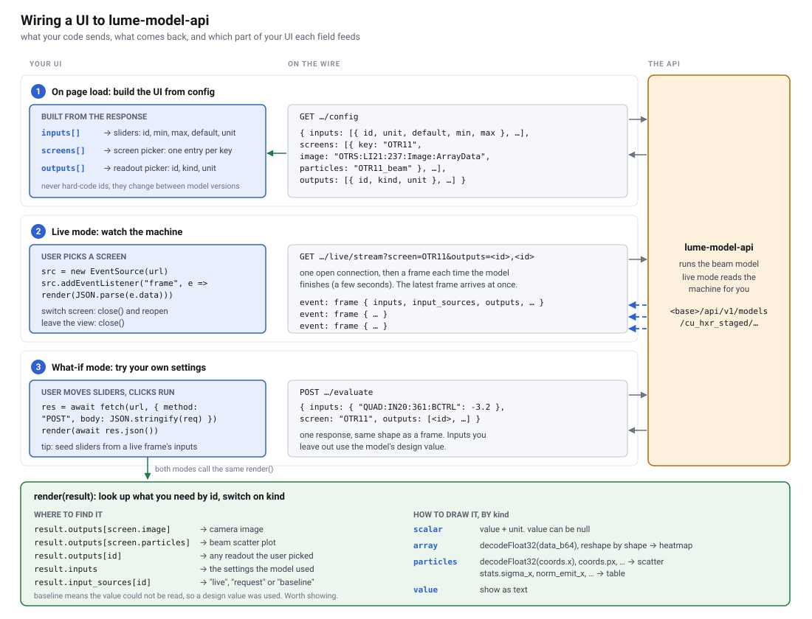

# Live streaming API quick start

The LUME model API runs a beam physics model using live machine values and sends the results
to the browser as a stream. This page covers the basics. See [API.md](API.md) for the full
reference.



For where these requests go inside the deployment, see [ui-backend-communication.svg](ui-backend-communication.svg).

## Base URL

```
https://ad-accel-online-ml-dev.slac.stanford.edu/lume-model-api
```

This is the dev deployment, reachable from the SLAC network only. You can try every endpoint
in the browser at `<base>/docs`.

## Step 1: Get the model's inputs, outputs and screens

| Request | Returns |
|---|---|
| `GET <base>/api/v1/models` | The available models, e.g. `cu_hxr_staged` |
| `GET <base>/api/v1/models/cu_hxr_staged/config` | That model's inputs, outputs and screens |

The `config` response has two lists you'll use for streaming:

- `outputs`: every value the model can produce. Each one has an `id`, a `kind` and a `unit`.
- `screens`: diagnostic screens, such as `OTR11`. Requesting a screen gives you both its beam
  particles and its camera image.

Use the ids from `config` in your code rather than typing them in by hand, since they can change
between model versions.

## Step 2: Connect to the stream

The stream URL takes a `screen`, a comma-separated list of `outputs`, or both:

```
<base>/api/v1/models/cu_hxr_staged/live/stream?screen=OTR11
<base>/api/v1/models/cu_hxr_staged/live/stream?outputs=BEND:IN20:661:BACT,BEND:IN20:751:BACT
```

The stream uses Server-Sent Events, which browsers support through `EventSource`:

```js
const base = "https://ad-accel-online-ml-dev.slac.stanford.edu/lume-model-api";
const url = `${base}/api/v1/models/cu_hxr_staged/live/stream?screen=OTR11`;
const source = new EventSource(url);

source.addEventListener("frame", (event) => {
  const frame = JSON.parse(event.data);
  const image = frame.outputs["OTRS:LI21:237:Image:ArrayData"];
  const beam = frame.outputs["OTR11_beam"];
  // draw image and beam here
});

source.addEventListener("error", (event) => {
  if (event.data) {
    // The server sent an error message. The stream normally continues afterwards.
    console.warn(JSON.parse(event.data).message);
  }
  // With no data, the connection dropped. EventSource reconnects automatically.
});
```

When the user leaves the page or view, call `source.close()`. The server keeps running the model
for as long as a stream is open.

New frames are sent as soon as the model finishes computing, so there's no fixed rate and a frame
can take a few seconds. When you first connect, you receive the most recent frame right away.

## Step 3: Read the frame

Each frame contains:

| Field | Meaning |
|---|---|
| `timestamp` | When the frame was computed (Unix seconds) |
| `frame_index` | Frame number. It always increases but can skip numbers |
| `inputs` | The machine values the model used |
| `input_sources` | For each input, `"live"` (read from the machine) or `"baseline"` (couldn't be read, so a design value was used) |
| `outputs` | The values you asked for, keyed by output id |

Each output has a `kind` that tells you what fields it has:

| `kind` | Fields | Typically used for |
|---|---|---|
| `scalar` | `value`, `unit` | Single numbers. `value` is `null` if the model couldn't compute it |
| `array` | `shape`, `data_b64`, `unit` | Camera images and profiles |
| `particles` | `n`, `coords`, `stats`, `units` | Beam scatter plots. `coords` has `x`, `px`, `y`, `py`, `z`, `pz` and `weight`. `stats` has values such as `sigma_x` and `norm_emit_x` |
| `value` | `value` | Text and other non-numeric values |

Arrays and particle coordinates are sent as base64-encoded 32-bit floats. To decode them:

```js
function decodeFloat32(b64) {
  const bytes = Uint8Array.from(atob(b64), (c) => c.charCodeAt(0));
  return new Float32Array(bytes.buffer);
}

const pixels = decodeFloat32(image.data_b64); // row-major, sized by image.shape
const x = decodeFloat32(beam.coords.x);       // beam.n values
```

Values come in the model's own units, and the server doesn't convert them. Display the `unit` that
comes with each value.

## Errors and limits

- If the request itself is wrong, for example an output id that doesn't exist, the server returns
  an HTTP error (`400`) and the stream never opens. `EventSource` doesn't show you the status
  code, so while developing, open the stream URL directly in a browser tab or with `curl -N` to
  see the error message.
- The server starts one model loop for each different combination of outputs, and the number of
  loops is limited. When the limit is reached, a new combination gets a `503` error. Users who
  request the same combination share a loop, so it helps to settle on a small number of fixed
  output sets for your app.
- If you receive an error saying the pod must restart, the model has crashed. The service
  restarts by itself within about a minute and `EventSource` reconnects. It's worth showing users
  a message while this happens.
- This is a development deployment, so it may restart or change without notice.
